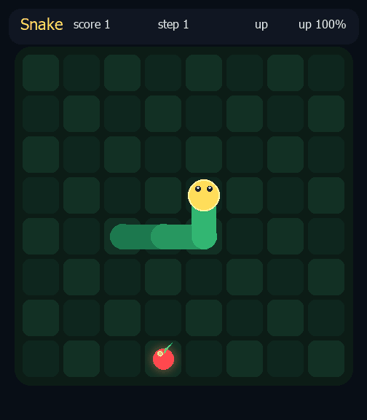

# Decision Snake

I wanted to see if a small downloaded decision model could play snake, and if reinforcement learning could improve its decisions without retraining its weights.



The clip is one real game: an 8×8 board, seed 7, played by the combination below. Every move is in the clip. It is sped up so it can sit on this page. On the local page each cell stays up long enough to follow, because the fast moves used to disappear before the browser painted them.

The model reads the board as text. It keeps control while its path is new. When the route repeats, or the next step would close the way back to the tail, a learned network may take a step that is closer to the apple. If the network has no such step, search finishes that chase and hands the board back. This game filled the board. Score 61, in 978 steps.

## What I tested

[d3-edge](https://huggingface.co/vllm-sr/d3-edge) is a decision model of about 0.8 billion parameters, built on Qwen3.5. The machine was a GTX 1650 with 4 GB. It has no bfloat16 CUDA kernels, so the weights load in float16 and occupy 1.11 GB. I did not fine-tune them. A training run of 200,000 looks, at more than a second each, would be days of inference, and the decision layer is a readout over labels.

I sent the same opening both ways. Seed 7, the apple above the head. From a picture of the board the model chose right four times and hit the wall. Score 0. From a coordinate matrix its own first choice was up, and the next choice ate the apple.

Giving it the body as coordinates made the opening correct, then it died on step 8 with score 2. I added the path the head had walked since the last apple, and the result of each legal move: closer or farther, and whether the cell is empty, the apple, the body, a wall, or a cell already left. Alone, that text reached score 9 in 135 steps, and it died on its own body. The model can read the next cell. It does not search the future shape of a long snake.

I also tried to make the network copy the model. That made the network worse, which is why the live player does not copy. Shifting the training reward toward the model's recorded preference dropped the average score from about 16 to 0.4. Adding that preference on top of the network's score at decision time left the snake alive and it almost never ate, because the recorded model had given left turns almost no weight.

Trained on its own, Double DQN reached about 16, close to a plain rule that steps toward the apple when the next cell is safe (about 18). An earlier reward had punished eating, and an earlier input was the whole board as a flat list. Those runs stayed near a score of 2 or 3.

A network that only refuses a fatal move keeps the snake alive in a circle. On the early text it was still at score 2 after 285 steps. Handing it control when the path repeats reached score 18, then it hit itself. The richer text plus that handoff scored 13 and died at step 133. Letting the network pick any move that still reached the tail got to score 31, and then it circled. I stopped that run at step 800. It was alive, and it was not going to the apple.

The player behind Start is the next version of that idea.

- The model plays while the path is new and the move still leaves a way back to the tail.
- A move into a wall or the body is refused.
- When the route repeats, or the model's step would close that way, the network may move only if the step is closer to the apple and the tail stays reachable.
- If the network has no such step, search steers until the next apple. Then the model resumes.

On seed 7 the model ate 23 apples, including the last two. The network ate 12. Search ate 26. The board filled.

Search on its own, over 30 random 8×8 games and a cap of 2000 steps, averaged 56, filled 15 boards, and never died. It is in the menu as a comparison. The default calls it only for the chase the network cannot make.

## Speed

The model is the slow piece, not the fast one.

In the winning game the model was called 209 times: 186 moves it played, and 23 proposals that were replaced because they would have closed the path. Those calls took 276 seconds on the GPU, 1.3 seconds on average, from 0.8 to 2.0 seconds. The other 769 moves were the network or search.

I timed those two on the same 978 positions, on CPU, so the measurement would not share the GPU with the model. Search took 53 microseconds per move, 52 milliseconds for the whole game. The network took 121 microseconds per move, 118 milliseconds for the whole game. One model decision is about 25,000 times slower than search and about 11,000 times slower than the network.

A model-only game ends sooner only because it dies. At 1.3 seconds a decision, the 135-step game that scored 9 is about three minutes. The win spent four and a half minutes inside the model.

The page was skipping for a mechanical reason. It asks for the current board about four times a second and draws that one board. Search and the network replace the board in a fraction of a millisecond, so a burst of moves was gone before a single cell was painted. The model looked stepwise because it thinks for more than a second. Each board now stays up for three quarters of a second, long enough to animate one cell. Watching this win one cell at a time takes about fourteen minutes: four and a half of those are the model thinking, and the rest is the page waiting on the fast moves.

The averages below are the earlier trials that decided how to combine the two. The picture run is one recorded game. The rest are 30 boards.

| Player | Average score | What happened |
| --- | ---: | --- |
| d3-edge alone, the recorded game | 0 | Hit the wall on step 4 |
| DQN trained to copy the model | 0.4 | Died immediately |
| DQN plus the model's preference | 0.3 | Stayed alive and barely ate |
| Double DQN alone | 16 | Learned a middling policy, then usually died |
| Step toward the apple | 18 | Simple, and usually fatal |
| Search, up to 2000 steps | 56 | No deaths. 15 of 30 boards filled |

## Run it

```powershell
python -m venv .venv
.\.venv\Scripts\pip install torch torchvision --index-url https://download.pytorch.org/whl/cu126
.\.venv\Scripts\pip install -r requirements.txt
.\.venv\Scripts\python app.py
```

Open [http://127.0.0.1:7860](http://127.0.0.1:7860). The selected policy is d3-edge plus Double DQN. A model move takes about 1.3 seconds. A network or search move is held on screen for three quarters of a second so the cell is actually drawn. `transformers==5.17.0` is required.

One full game from the terminal, the same seed as the clip:

```powershell
.\.venv\Scripts\python app.py --episode --policy guided --seed 7 --size 8
```
