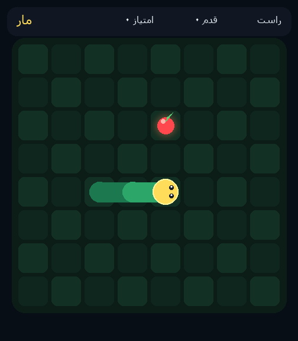

# مار تصمیم‌گیر · d3-edge Snake

بازی مار که در هر لحظه مدل [vllm-sr/d3-edge](https://huggingface.co/vllm-sr/d3-edge) با دیدن تصویر فارسی صفحه تصمیم می‌گیرد به کدام سمت برود.



## اجرا

```powershell
python -m venv --system-site-packages .venv
.\.venv\Scripts\pip install -r requirements.txt
.\.venv\Scripts\python app.py
```

بعد برو به [http://127.0.0.1:7860](http://127.0.0.1:7860).

یک دست بدون مرورگر:

```powershell
.\.venv\Scripts\python app.py --episode --seed 7 --size 8 --max-steps 10
```

مدل روی CPU هم کار می‌کند؛ هر قدم ممکن است حدود یک دقیقه طول بکشد.

## وابستگی‌ها

به `transformers==5.17.0` نیاز است چون d3-edge روی Qwen3.5 سوار است.
